# ROS 2 RMW adapter detailed design

**Design status:** Current for the bounded foundation, complete Jazzy proxy ABI
surface, lifecycle semantics, G4.1 memory-safety qualification, bounded
type/name/codec/QoS foundations, publisher packet/ownership, subscription
ingress/history/take, executor-facing wait semantics, generic type-support
resolution, and same-host best-effort/reliable networked topics with G4.2
qualification; Planned for G4.3 through G4.5 evidence

**Requirements:** ORT-RMW-001, ORT-RMW-002, ORT-RMW-003, ORT-RMW-004

**Requirements:** ORT-RMW-005, ORT-RMW-006, ORT-RMW-007, ORT-RMW-008

**Requirements:** ORT-RMW-009, ORT-RMW-010, ORT-RMW-011, ORT-RMW-012

**Requirements:** ORT-RMW-013, ORT-RMW-014, ORT-RMW-015, ORT-RMW-016

**Requirements:** ORT-RMW-017, ORT-RMW-018, ORT-RMW-019, ORT-RMW-020

**Requirements:** ORT-RMW-021, ORT-RMW-022

**Requirements:** ORT-RMW-023, ORT-RMW-024, ORT-RMW-025, ORT-RMW-026

**Requirements:** ORT-RMW-027, ORT-RMW-028

**Requirements:** ORT-RMW-029, ORT-RMW-030, ORT-RMW-031, ORT-RMW-032

**Requirements:** ORT-RMW-033

**Requirements:** ORT-RMW-034, ORT-RMW-035, ORT-RMW-036

**Requirements:** ORT-RMW-037, ORT-RMW-038, ORT-RMW-039

**Requirements:** ORT-RMW-040, ORT-RMW-041

**Requirements:** ORT-RMW-042

**Requirements:** ORT-RMW-043, ORT-RMW-044

**Requirements:** ORT-RMW-045, ORT-RMW-046

**Requirements:** ORT-RMW-047, ORT-RMW-048

**Requirements:** ORT-RMW-049, ORT-RMW-050

**Requirements:** ORT-RMW-051, ORT-RMW-052

**Requirements:** ORT-RMW-053, ORT-RMW-054

**Requirements:** ORT-RMW-055, ORT-RMW-056

## Status and scope

`rmw_openrtdds_cpp` is a separate ROS-facing shared library layered over the
OpenRTDDS C++ library. The first target is ROS 2 Jazzy on Linux. The exact
reviewed `rmw` header baseline is version `7.3.4` and upstream `package.xml`
blob `6b81eedd240033dcd695d5fa14511b0e41cdfd39`. The package accepts the bounded
Jazzy patch range `>=7.3.3,<7.4.0`; CI currently compiles and runs against the
7.3.3 package in `ros:jazzy-ros-core`. A version outside that range fails at
configure time. Rolling is a reference, not the compatibility target.

This design covers lifecycle, pub/sub, wait/take, graph, services, metadata,
QoS, errors, bounds, and qualification. DDS Security, SROS 2, dynamic types,
content filtering, loaned messages, zero-copy, and network-flow endpoints are
deliberately excluded from the initial profile.

See [the capability-gap matrix](capability-matrix.md) for the feature-to-gate
plan.

## Current bounded foundation

`include/openrtdds/rmw/foundation.hpp` supplies the ROS-independent ownership
layer that future C entry points will wrap. `src/rmw/foundation.cpp` supplies
stable diagnostic names. The unit owner is `tests/test_rmw_foundation.cpp`,
and `examples/rmw_foundation_lifecycle.cpp` demonstrates a complete bounded
context, node, guard-condition, shutdown, release, and finalize sequence. The
upstream selection evidence is recorded in `rmw_openrtdds_cpp/BASELINE.md`.

The foundation is compiled into `OpenRTDDS::openrtdds`; it includes no ROS
headers. The separate `rmw_openrtdds_cpp` ament package registers and exports a
loadable shared library with the complete reviewed Jazzy proxy symbol surface
and the C/C++ introspection type-support backends. The current adapter can
complete lifecycle and same-host volatile KEEP_LAST best-effort and bounded
reliable topic exchange through standard runtime selection. It also provides
the selected bounded OpenRTDDS-to-OpenRTDDS graph discovery and query profile
defined by G4.3. Vendor-native ROS graph exchange, services/clients, endpoint
information arrays, and general executor compatibility are not yet claimed.

### Current types and ownership

| Type | Current responsibility | Bound/lifetime |
|---|---|---|
| `AdapterLimits` | validates runtime node and guard-condition limits against template capacities | copied into a successfully initialized context |
| `AdapterConfig` | supplies limits, portable domain ID, and exact implementation identifier | caller-owned input, never retained by pointer |
| `AdapterContext<N,G>` | owns fixed node/guard slots, lifecycle, context generation, and wake generation | static or caller-owned object; no heap allocation |
| `NodeHandle` | identifies one node slot plus slot/context generations | valid only while its exact slot instance is active |
| `GuardConditionHandle` | identifies one guard slot plus slot/context generations | valid only while its exact slot instance is active |
| `AdapterError` | exact immediate foundation result | symbolic; integer values are not persistent diagnostics |

Node records contain fixed arrays for name and namespace. Guard-condition
trigger generations and the context wake generation are atomics. Lifecycle,
node, and guard slot creation/destruction are deliberately single-owner in
this increment; only trigger/wake generation storage is prepared for the later
concurrent wait-set boundary. Concurrent destroy/trigger behavior remains
Planned under ORT-RMW-009 and ORT-RMW-016.

### Current behavior and invariants

- initialization commits only after identifier, limits, and portable domain
  ID (`0..232`) validation succeeds;
- failed creation leaves the output handle and slot counts unchanged;
- each initialization and slot reuse advances a wrapping nonzero generation;
- node and guard handles must match context, slot, and slot generation;
- shutdown advances the wake generation and prohibits new/trigger operations;
- objects may be released during shutdown, and the final release transitions
  the context to `finalizable`;
- finalization is rejected while an object remains owned;
- no operation allocates, creates a thread, blocks, invokes a callback, or
  performs I/O.

### Current normal sequence

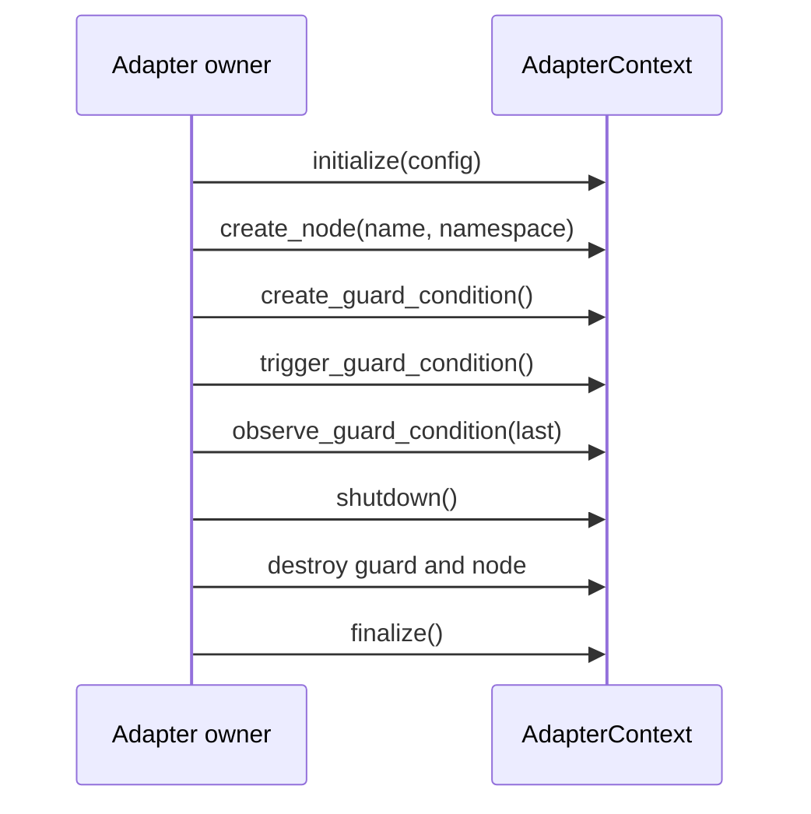

### Current error and fault mapping

| `AdapterError` | Meaning | Planned external mapping |
|---|---|---|
| `invalid_argument` | null/empty required input | `RMW_RET_INVALID_ARGUMENT` |
| `incorrect_implementation` | identifier differs from `rmw_openrtdds_cpp` | `RMW_RET_INCORRECT_RMW_IMPLEMENTATION` |
| `invalid_limits` | zero or over-capacity startup limit | `RMW_RET_INVALID_ARGUMENT`, `ORT-FLT-RMW-002` |
| `invalid_domain` | domain exceeds initial portable bound | `RMW_RET_INVALID_ARGUMENT` |
| `invalid_state` | lifecycle ordering violation | `RMW_RET_ERROR`, `ORT-FLT-RMW-001` |
| `resource_exhausted` | active configured slot limit reached | `RMW_RET_BAD_ALLOC`, `ORT-FLT-RMW-002` |
| `name_too_long` | name or namespace lacks terminator inside bound | `RMW_RET_INVALID_ARGUMENT` |
| `stale_handle` | context/slot generation or active state mismatch | `RMW_RET_ERROR`, `ORT-FLT-RMW-001` |
| `unsupported` | reserved for truthful unsupported semantics | `RMW_RET_UNSUPPORTED` |

The Jazzy lifecycle wrapper maps these results to `rmw_ret_t`; later entity
families shall reuse the same mapping rather than invent local return policy.

## Current Jazzy C ABI and lifecycle scaffold

`rmw_openrtdds_cpp/src/rmw_adapter.cpp` owns ROS context, node, and guard ABI
objects and wraps the bounded foundation. Dedicated sources own publisher,
subscription, wait, type-support, codec, QoS, and network behavior.
`rmw_openrtdds_cpp/src/rmw_unsupported.cpp` supplies type-correct definitions
for every remaining function required by the pinned Jazzy proxy. The reviewed
`rmw_openrtdds_cpp/abi_symbols.txt` manifest contains all 95 exports: 94
macro-routed proxy functions plus the separately dispatched `rmw_init`.

The proxy reference is `ros2/rmw_implementation` Jazzy commit
`835ff87c676cd65634edd3ad7ba88c8d8a0452e7`, with `src/functions.cpp` blob
`6201e037b7997bea8f66c552f2075887a62adf92`. Any baseline change requires a
manifest diff, header compatibility review, and CI evidence before acceptance.

The ament resource index contains `rmw_openrtdds_cpp` and registers Jazzy C and
C++ introspection. Bounded publisher, subscription, wait/take, and best-effort
network APIs are implemented in their dedicated sections below. Graph-cache,
service, client, event, generic serialization, and remaining optional APIs
retain the unsupported contract. All optional features return `false` from
`rmw_feature_supported`.

### Unsupported-entry-point contract

An exported symbol does not imply implemented semantics. Every unimplemented
entry point follows a return-type-specific policy and must leave adapter state
unchanged.

| Return family | Required result | Diagnostic policy |
|---|---|---|
| `rmw_ret_t` | `RMW_RET_UNSUPPORTED` | set an `rcutils` error naming the unsupported function |
| created-handle pointer | `nullptr` | set an `rcutils` error naming the unsupported function |
| capability query `bool` | `false` | do not set an error; unsupported is the query result |

Stub definitions use the official Jazzy declarations so signature drift is a
compile error. They do not allocate, dereference caller objects, mutate
contexts or handles, invoke callbacks, create threads, or perform I/O.

### ABI ownership

| Object | Allocation and ownership | Release rule |
|---|---|---|
| `rmw_init_options_t` owned fields | caller-provided `rcutils_allocator_t`; security, discovery, and enclave are deep-copied | `rmw_init_options_fini` |
| `rmw_context_impl_t` | context allocator; placement-constructed C++ foundation | only after shutdown and release of all external handles |
| `rmw_node_t`, node data, name, namespace | context allocator; one bounded foundation node slot | `rmw_destroy_node`, including during shutdown |
| user `rmw_guard_condition_t` and data | context allocator; one bounded foundation guard slot | `rmw_destroy_guard_condition`, including during shutdown |
| graph guard condition | context-owned; reserves one guard slot at initialization | automatically released by first shutdown |

### Implemented lifecycle sequence

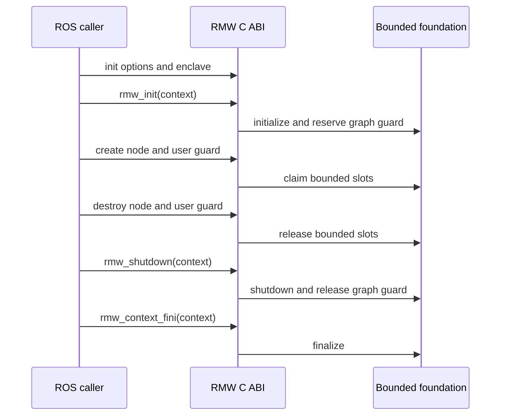

`rmw_shutdown` is idempotent. `rmw_context_fini` rejects an active context and
also rejects a shutdown context that still owns an external node or guard.
This preserves the underlying foundation's no-abandoned-handle invariant.

### Standard runtime-selection sequence

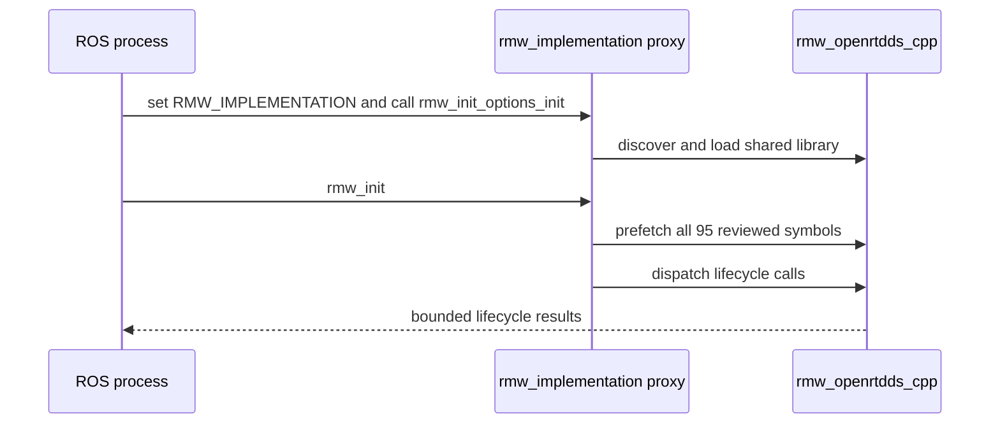

The proxy-linked test does not link directly to `rmw_openrtdds_cpp`. This
prevents link-time resolution from masking package discovery, loader, manifest,
or proxy-dispatch defects.

### Qualification boundary

The Jazzy CI job builds with `colcon`, runs direct lifecycle and unsupported
contract tests, checks ament registration, loads the installed shared library,
and compares all `rmw_*` dynamic exports with `abi_symbols.txt`. A second
lifecycle executable links only to `rmw_implementation`, selects this adapter
with `RMW_IMPLEMENTATION=rmw_openrtdds_cpp`, and exercises proxy load, full
symbol prefetch, and lifecycle dispatch.

PR26 adds a caller-supplied accounting allocator and exercises 256 complete
lifecycle cycles at the configured maximum of eight nodes and fifteen user
guards (the graph guard owns the sixteenth slot). Every cycle deliberately
exceeds both pools, verifies atomic rejection, shuts down with live objects,
releases them, finalizes, and requires zero outstanding allocations. Separate
failure sweeps reject each partial context, graph-guard, node, and guard
construction edge, verify allocation and slot rollback, then perform a valid
recovery operation.

The sanitizer job instruments the adapter, its ROS-free OpenRTDDS dependency,
and all lifecycle executables with AddressSanitizer and
UndefinedBehaviorSanitizer. Leak detection is enabled and failures stop the
job. It covers direct and proxy-selected lifecycle paths, invalid null and
foreign-implementation inputs, resource exhaustion, allocation fault
injection, and repeated cleanup.

Passing these checks qualifies ORT-RMW-029 through ORT-RMW-039 and closes
G4.1. This proves that the documented lifecycle scaffold loads and survives
the tested memory and fault paths; it does not qualify endpoint, wait-set,
graph, service, client, executor, or general ROS application behavior.

## Current bounded publisher foundation

PR30 established publisher ownership and packet production. PR33 connects that
state to the bounded best-effort worker, so SEDP and DATA are now transmitted
and the matched count reflects compatible discovered readers. ORT-RMW-004
remains Draft because reliable repair and the full G4.2 C/C++ evidence are not
complete; the ROS graph still has no logical publisher record.

### API and interface surface

| Interface | Current behavior |
|---|---|
| `rmw_create_publisher` | validates all inputs, claims one of eight context slots, allocates complete bounded storage, builds SEDP, and commits the handle |
| `rmw_destroy_publisher` | validates exact parent ownership, releases all storage, returns the slot, and decrements the node count; allowed after shutdown |
| `rmw_publish` | synchronously serializes XCDR1, builds one unfragmented RTPS DATA message, timestamps, and commits KEEP_LAST history |
| `rmw_get_gid_for_publisher` | copies the immutable 16-byte RTPS writer GUID into caller storage |
| `rmw_publisher_get_actual_qos` | returns the PR29 normalized profile used by SEDP and storage planning |
| `rmw_publisher_count_matched_subscriptions` | returns the worker cache's current compatible remote-reader count |
| `inspect_publisher` | returns a locked diagnostic snapshot and borrowed packet views for qualification; it is not an `rmw` ABI entry point |

Loaned messages, serialized-message publishing, publisher events, liveliness
assertion, allocation objects, acknowledgment waiting, and unique network-flow
guarantees remain explicitly unsupported. A strictly-required unique network
flow is rejected during creation; optional or system-default requests do not
claim that guarantee.

### Classes and ownership

| Type | Responsibility | Ownership/lifetime |
|---|---|---|
| `PublisherSlot` | bounded context registry entry with nonzero reuse generation | fixed array of eight in `rmw_context_impl_t` |
| `PublisherData` | type metadata, mapped names, resource plan, GUID, packet/history storage, sequence state, and mutex | context allocator; one per committed `rmw_publisher_t` |
| `PublisherSampleMetadata` | sequence, source timestamp, and exact serialized byte count | fixed 1,024-entry array; active depth is normalized KEEP_LAST depth |
| `PublisherSnapshot` | coherent qualification view of endpoint and last commit | caller-owned copy; packet pointers remain publisher-owned |
| `NodeData::publisher_count` | prevents parent release while a child publisher exists | updated only at publisher commit/destruction |

The `rmw_publisher_t`, private `PublisherData`, copied topic string, and one
contiguous runtime byte region are the four allocator-owned construction
edges. The runtime region is partitioned once:

```text
[maximum XCDR1 staging]
[RTPS DATA construction buffer = sample + 44 bytes]
[committed RTPS DATA datagram = sample + 44 bytes]
[KEEP_LAST depth × maximum XCDR1 sample]
```

The maximum analyzed XCDR1 sample is 65,000 bytes. This keeps an unfragmented
DATA packet below the 65,507-byte UDP payload ceiling. History depth is at
most 1,024 and total history storage is at most 64 MiB under the PR29 resource
plan. No runtime resize or fragmentation fallback exists.

### Creation behavior

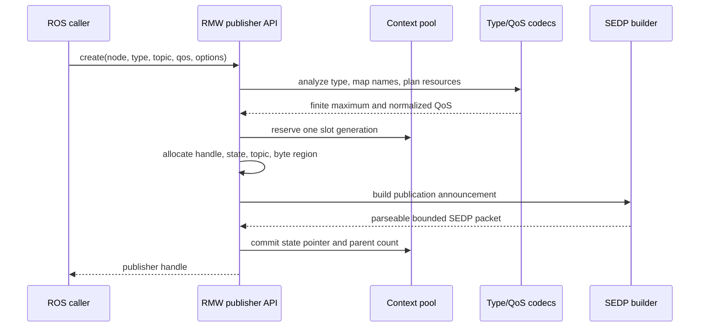

Validation and resource planning occur before slot reservation. Allocation or
SEDP failure destroys every completed object, returns every allocation, and
advances/releases the reserved slot generation. Only the final assignment of
the slot data pointer and node ownership count makes the publisher visible.
Publisher creation/destruction and node/context finalization are lifecycle
operations and are not permitted concurrently.

The participant GUID prefix contains the OpenRTDDS identity marker, domain,
and context instance ID; the final four GID bytes are the user-writer EntityId
derived from the bounded publisher slot. Reusing a slot may reuse its EntityId
within one context only after the old publisher is destroyed; applications
must not retain destroyed endpoint identities.

### Publish behavior and commit point

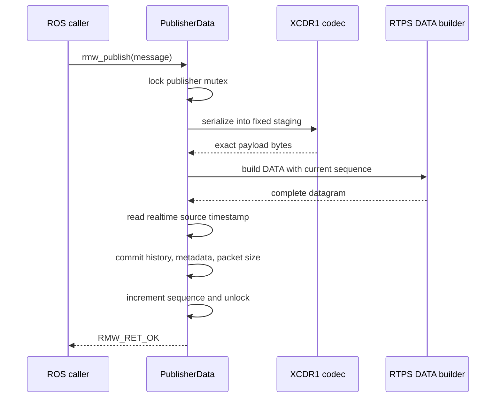

Serialization, DATA construction, sequence-range checking, and timestamp
acquisition all precede the commit point. DATA is built into a private
construction buffer and copied to the visible packet only at commit. Any
failure returns without changing history indices, visible packet bytes/size,
last-sample metadata, or next sequence.
Successful KEEP_LAST insertion overwrites the oldest slot after the configured
depth is full. The current DATA builder does not emit `INFO_TS`; the timestamp
is retained as local RMW metadata for the later subscription/message-info
path. Network transmission will consume the committed datagram in PR33.

All operations on one live publisher except finalization serialize through its
mutex, matching the Jazzy publisher thread-safety contract. Calls do not wait
for discovery, acknowledgments, or network events. Mutex acquisition is the
only blocking operation and remains subject to scheduler starvation; no
internal thread or callback is created in this increment.

### Error and fault behavior

| Failure | RMW result | State effect | Fault mapping |
|---|---|---|---|
| null/invalid argument or wrong parent | `RMW_RET_INVALID_ARGUMENT` | none | integration error |
| foreign implementation identifier | `RMW_RET_INCORRECT_RMW_IMPLEMENTATION` | none | `ORT-FLT-RMW-001` |
| exhausted publisher pool/allocation | null from create | reservation fully rolled back | `ORT-FLT-RMW-002` |
| unsupported/unbounded type | null from create | no slot retained | `ORT-FLT-RMW-003` |
| unsupported QoS | null from create | no slot retained | `ORT-FLT-RMW-006` |
| XCDR1 bound/serialization failure | `RMW_RET_ERROR` | no publish commit | `ORT-FLT-SER-001` or codec mapping |
| RTPS DATA construction/sequence failure | `RMW_RET_ERROR` | no publish commit | `ORT-FLT-RTPS-003` or local configuration defect |
| realtime clock failure | `RMW_RET_ERROR` | no publish commit | `ORT-FLT-TIME-001` |
| publish after shutdown | `RMW_RET_ERROR` | none | `ORT-FLT-RMW-001` |
| node/context release with live publisher | error/invalid argument | parent remains valid | `ORT-FLT-RMW-001` |

Every public failure sets the bounded `rcutils` diagnostic. The fault codes
remain classifications for application/health-monitor integration; this PR
does not emit an asynchronous fault event.

### Verification and known boundary

`test_publisher.cpp` parses the constructed SEDP and RTPS DATA packets, checks
ROS-to-DDS names, endpoint identity, normalized QoS, source timestamp,
sequence progression, XCDR1 payload recovery, KEEP_LAST accounting, pool
exhaustion, wrong-parent rejection, shutdown behavior, and state preservation
after a failed publish. `test_rmw_memory_qualification.cpp` injects failure at
each of the four publisher allocations, checks exact allocation balance and
slot recovery, and then creates and destroys a valid publisher. The sanitizer
job runs both tests. `publisher_pipeline.cpp` demonstrates the direct C ABI
creation/publish/inspection lifecycle.

The direct publisher evidence verifies packet production and ownership. PR33's
network and rclcpp tests additionally verify best-effort transmission and
matching. G4.2 still requires reliable repair and the full C/C++ application
matrix.

## Current bounded subscription foundation

PR31 established reader ownership, accepted-DATA history, and caller-driven
take. PR32 added wait readiness and PR33 connects a context UDP worker plus
discovery matching to the same ingress boundary. ORT-RMW-005 remains Draft
until reliable receive/repair and complete G4.2 evidence exist.

### Subscription API and interface surface

| Interface | Current behavior |
|---|---|
| `rmw_create_subscription` | validates inputs, reserves one of eight context slots, allocates complete history, builds the SEDP reader announcement, then commits ownership |
| `rmw_destroy_subscription` | requires the exact parent node, releases all storage and the pool slot, and remains valid after shutdown |
| `receive_data_message` | parses one complete RTPS DATA message, applies reader/writer/time/size filters, suppresses duplicates, and commits KEEP_LAST payload plus metadata |
| `rmw_take` | nonblocking XCDR1 decode of the oldest accepted sample into caller storage |
| `rmw_take_with_info` | performs the same take and supplies source/receive time, writer GID, publication sequence, and reception sequence |
| `rmw_take_sequence` | decodes up to the requested count into caller-provided message pointers and metadata storage, then consumes the batch atomically |
| `rmw_subscription_get_actual_qos` | returns the normalized profile used for resource planning and SEDP |
| `rmw_subscription_count_matched_publishers` | returns zero until remote discovery matching exists |
| `inspect_subscription` | returns a locked diagnostic snapshot plus a borrowed SEDP packet view; it is not an `rmw` ABI entry point |

Serialized takes, loaned takes, content filtering, events, network-flow
guarantees, discovery matching, fragmentation/reassembly, and reliable repair
remain unsupported. Strictly required unique network flows and content-filter
options are rejected during creation. `can_loan_messages` and
`is_cft_enabled` are false.

### Subscription classes and fixed ownership

| Type | Responsibility | Bound/lifetime |
|---|---|---|
| `SubscriptionSlot` | registry entry and nonzero reuse generation | fixed array of eight in `rmw_context_impl_t` |
| `SubscriptionData` | parent/type identity, resource plan, reader GUID, history, writer states, counters, SEDP, and mutex | context allocator; one per committed handle |
| `SubscriptionSampleMetadata` | writer GID, publication/reception sequences, timestamps, and serialized size | fixed array of 1,024 records; active depth is the normalized KEEP_LAST depth |
| `WriterState` | last accepted sequence for one writer GUID | fixed table of 16 writers per subscription |
| `SubscriptionReceiveResult` | exact synchronous ingress outcome and sequence metadata | caller-owned output; overwritten on every ingress call |
| `SubscriptionSnapshot` | coherent diagnostic state and borrowed SEDP view | caller-owned copy; SEDP pointer remains subscription-owned |
| `NodeData::subscription_count` | prevents parent release with live child readers | incremented only at commit and decremented at destruction |

The four allocator-owned construction edges are the public
`rmw_subscription_t`, placement-constructed private state, copied topic name,
and one contiguous history region sized as normalized depth multiplied by the
maximum analyzed XCDR1 sample size.

The analyzed sample maximum is 65,000 bytes, history depth is at most 1,024,
and planned history is capped at 64 MiB by the shared QoS resource planner.
Metadata and the 16-entry writer table are inline in `SubscriptionData`; they
cannot grow. Lifecycle creation/destruction is serialized by the context
subscription-registry mutex. Ingress, take, query, and inspection on one live
subscription serialize through its entity mutex.

### Subscription creation and rollback

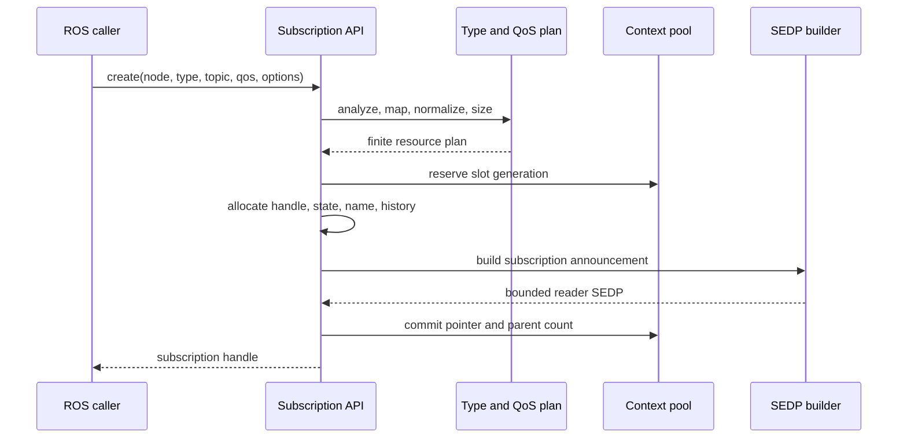

Validation and planning occur before slot reservation. On allocation or SEDP
failure, all completed objects are destroyed in reverse ownership order, the
slot is released with an advanced generation, and the node count is never
incremented. The allocation-failure qualification test injects failure at all
four edges and requires the allocator balance and subsequent creation to
recover each time.

The reader GUID uses the same participant prefix as PR30 publishers. Its
EntityId is derived from the bounded slot and uses RTPS no-key reader kind
`0x04`. SEDP addresses the built-in subscriptions reader and advertises the
mapped name, type, normalized reliability, volatile durability, and bounded
loopback locator. Reusing a slot after destruction may reuse the EntityId;
the previous handle is invalid because its slot generation no longer matches.

### DATA acceptance and history commit

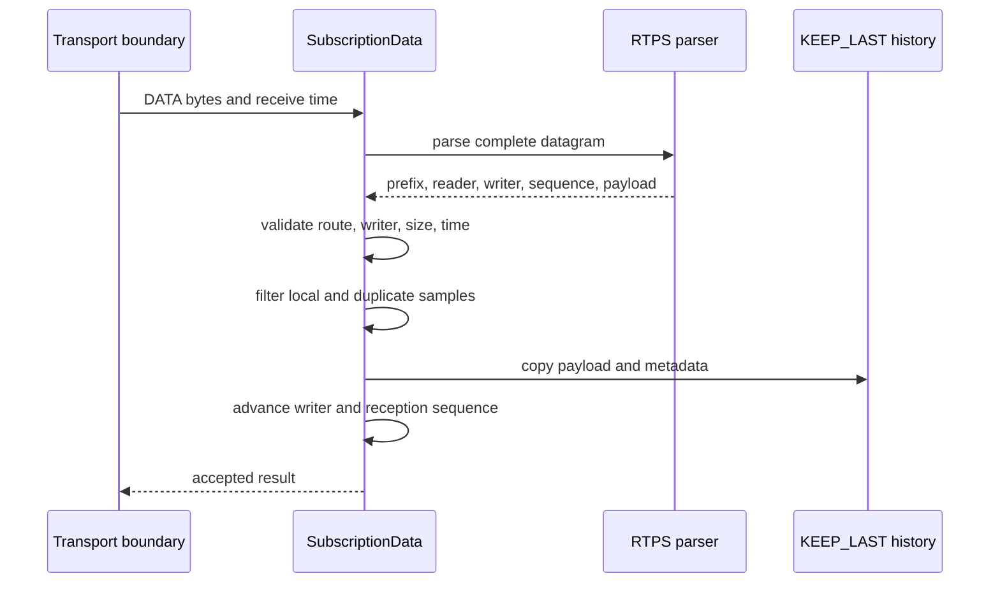

Ingress accepts DATA addressed to this reader or to the RTPS unknown-reader
EntityId. When `INFO_DST` is present, its participant prefix must also match
the local participant. The writer prefix must be nonzero and the EntityId must
be a valid user writer (`0x02` keyed or `0x03` no-key). Payload must be
nonempty and at most the analyzed XCDR1 maximum. Receive time must be positive
and representable by `rmw_time_point_value_t`; source time comes from the caller
when nonzero, otherwise a valid nonnegative `INFO_TS` is converted to
nanoseconds.

When `ignore_local_publications` is enabled, a writer with the context's local
participant prefix is reported as ignored and does not consume writer/history
state. Each observed writer uses one fixed state entry. A sequence less than
or equal to that writer's last accepted sequence is reported as duplicate or
stale and is not committed. Exhausting the 16-writer table rejects a new
writer without evicting an existing state.

The commit point begins only after every rejection condition is cleared. If
history is not full, the sample is appended at the ring tail. If full, the
oldest record is overwritten, the head advances, and `dropped_samples`
increments. The payload copy and its complete metadata precede publication of
the writer's new last sequence, reception sequence advance, and accepted
counter. The ingress function performs no allocation, callback, I/O, or wait.

### Take behavior and metadata

```mermaid
sequenceDiagram
    participant E as Executor caller
    participant S as SubscriptionData
    participant X as XCDR1 decoder
    E->>S: take(caller message storage)
    S->>S: lock and inspect oldest sample
    S->>X: validate and decode XCDR1
    alt decode succeeds
        X-->>S: complete ROS message
        S->>S: consume history record
        S-->>E: taken plus optional metadata
    else decode fails
        X-->>S: exact codec error
        S-->>E: error; sample remains queued
    end
```

An empty history returns `RMW_RET_OK` with `taken=false` (or zero sequence
size) and does not modify message or message-info storage. Decode uses the
PR28 two-pass XCDR1 path, so an invalid or undersized destination remains
unchanged. Only a successful decode advances the ring head. Batch take first
decodes every requested available record; if any decode fails, no history
record is consumed. It then commits both sequence sizes and the consumed count.

`rmw_message_info_t` contains the RTPS writer GUID as `publisher_gid`, the
wire DATA sequence as `publication_sequence_number`, the local monotonically
increasing accepted-sample sequence as `reception_sequence_number`, resolved
source time, supplied receive time, and `from_intra_process=false`. The latter
is deliberate because this boundary models DDS wire delivery rather than an
intra-process optimization.

### Subscription errors and fault containment

| Condition | API result | State effect / fault mapping |
|---|---|---|
| null, malformed, wrong-parent, or stale handle | null or `RMW_RET_INVALID_ARGUMENT` | no commit; `ORT-FLT-RMW-001` for stale lifecycle state |
| foreign implementation | `RMW_RET_INCORRECT_RMW_IMPLEMENTATION` | no state change |
| unsupported option, QoS, type, or name | null with exact diagnostic | no slot claim; `ORT-FLT-RMW-003` or `ORT-FLT-RMW-006` |
| slot/allocation/history bound exhausted | null | complete rollback; `ORT-FLT-RMW-002` |
| inactive context | ingress `inactive_context`; take `RMW_RET_ERROR` | history retained for orderly destruction; `ORT-FLT-RMW-001` |
| invalid time, reader, writer, payload, or RTPS syntax | exact `SubscriptionReceiveError`; false | no history or writer-state change |
| duplicate/stale or ignored-local DATA | true with outcome flag, `accepted=false` | deliberate filtered outcome; no fault and no commit |
| writer table full or reception sequence exhausted | exact ingress error; false | existing history/states preserved; `ORT-FLT-RMW-002` |
| empty take | `RMW_RET_OK`, not taken | caller message/info unchanged |
| XCDR1 destination/decode failure | `RMW_RET_ERROR` | sample remains queued; codec fault mapping applies |
| non-null allocation object | `RMW_RET_UNSUPPORTED` | no state change |

`SubscriptionReceiveError` is an internal synchronous vocabulary rather than
an asynchronous ROS status event. `rtps_parse_failed` additionally carries the
exact `RtpsError`. The later transport worker shall translate or count these
outcomes without calling user code while holding the subscription mutex.

### Verification and known boundary

`test_subscription.cpp` checks reader SEDP parsing, actual QoS, empty take,
accepted metadata, duplicate suppression, local-publication filtering,
KEEP_LAST overflow, ordered batch take, eight-slot exhaustion, ownership,
shutdown behavior, and cleanup. `test_rmw_memory_qualification.cpp` covers all
subscription allocation failures and recovery. The subscription pipeline
example connects the PR30 committed DATA buffer directly to ingress and takes
one typed sample with metadata.

This evidence proves the bounded synchronous interface, not a networked ROS
subscription. PR32 owns wait/readiness wake semantics. PR33 owns context UDP
receive integration, discovery matching, and real C/C++ talker/listener
qualification required to close G4.2.

## Architectural boundary

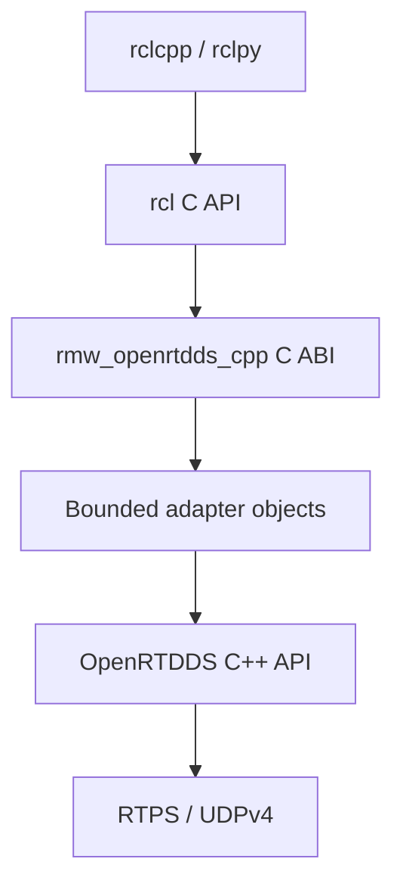

The adapter owns ROS ABI objects and conversion policy. OpenRTDDS owns DDS and
RTPS state. `rcl` and the caller own the memory passed into entry points. No
ROS headers enter the OpenRTDDS public C++ headers; the core library remains
buildable without a ROS installation.

## Package and source ownership

The planned source tree is:

```text
rmw_openrtdds_cpp/
  CMakeLists.txt
  package.xml
  include/rmw_openrtdds_cpp/visibility_control.h
  src/entry_points.cpp
  src/context.cpp
  src/entities.cpp
  src/type_support.cpp
  src/qos.cpp
  src/wait_set.cpp
  src/graph.cpp
  src/services.cpp
  src/errors.cpp
  test/
```

Whether this package remains in this repository or moves to a dedicated ROS
repository is a release-management decision. Its API and trace obligations are
unchanged. The core build shall not find or link ROS unless the adapter option
is explicitly enabled.

## Planned class and type definitions

| Type | Ownership and responsibility | Bound/lifetime |
|---|---|---|
| `RmwContext` | owns limits, domain, participant, transport workers, graph, entity pools, wait registry, and shutdown state | one per initialized `rmw_context_t`; finalized after shutdown |
| `RmwNode` | logical ROS node identity and graph record | context pool; destroyed before context finalization |
| `RmwPublisher` | writer, type support, mapped names, QoS, GID, and publication sequence | context pool; parent node must remain valid |
| `RmwSubscription` | reader, type support, QoS, receive history, readiness generation | context pool; parent node must remain valid |
| `RmwClient` | request writer, response reader, client GID, and outstanding-request table | context pool with fixed request bound |
| `RmwService` | request reader, response writer, and request-correlation records | context pool with fixed request bound |
| `RmwWaitSet` | caller-selected wait entries and wake generation snapshot | context pool; no ownership of waited entities |
| `RmwGuardCondition` | atomic trigger generation and wait-registry link | context pool; trigger is level-observable until consumed |
| `GraphCache` | local/remote nodes and endpoints plus committed generation | fixed-capacity context member |
| `TypeSupportView` | validated introspection metadata and maximum serialized size | immutable; refers to caller/ROS static metadata |
| `ErrorState` | bounded thread-local message for the last adapter failure | one record per calling thread |

Opaque `rmw_*_t::data` fields point to these objects. Every object also stores
the adapter identifier, context generation, lifecycle state, and pool slot
generation. A stale handle therefore fails validation even if its former slot
has been reused.

## Context and entity state

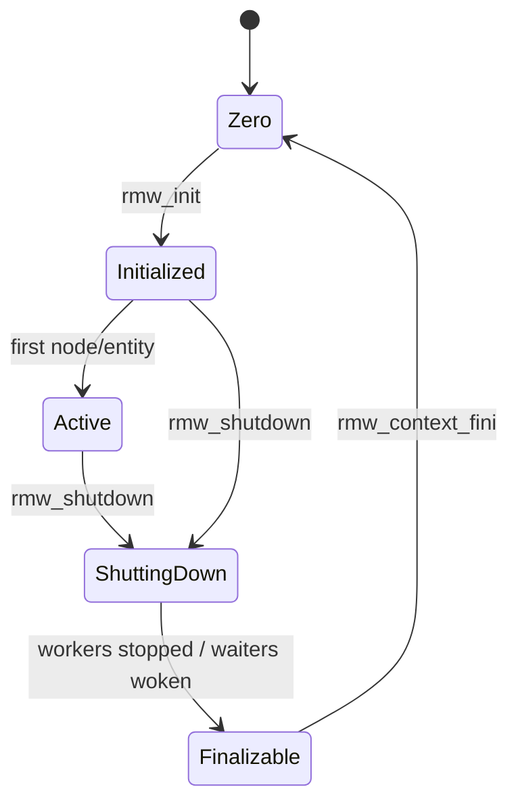

Entity slots use `free`, `constructing`, `active`, and `destroying` states.
Creation reserves a slot, validates and constructs all subordinate state, then
commits it to `active` and publishes one graph update. Any failure unwinds the
reserved state and leaves no visible graph entry. Destruction first prevents
new operations, wakes relevant waiters, removes the graph entry, releases DDS
state, advances the slot generation, and finally returns the slot to `free`.

## Initialization behavior

`rmw_init_options_init` records the caller allocator and initializes the ROS
security and discovery options without allocating OpenRTDDS runtime objects.
`rmw_init` performs:

1. adapter-identifier and lifecycle validation;
2. domain and localhost/discovery-option validation;
3. deterministic-limit loading and cross-bound validation;
4. pool, graph, wait-registry, socket, and worker creation;
5. SPDP/SEDP participant activation;
6. context commit only after all prior steps succeed.

Safety Profile activation pre-faults and locks declared memory, constructs the
fixed worker set, and closes all post-activation heap paths. A setup failure
unwinds in reverse order before the context is exposed.

## Publisher sequence

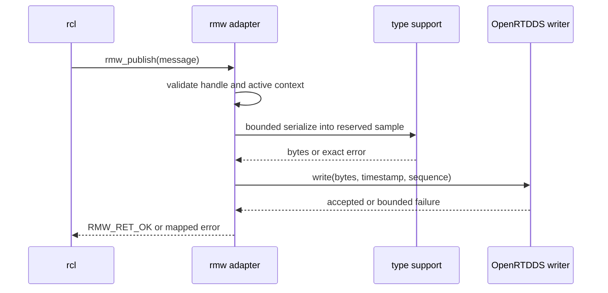

Serialization failure releases the reserved sample and does not advance the
published sequence. A DDS write failure returns the exact mapped error; the
reliability layer owns any already-committed sample according to its bounded
history and repair policy. The adapter never loops until success.

## Current subscription and wait sequence

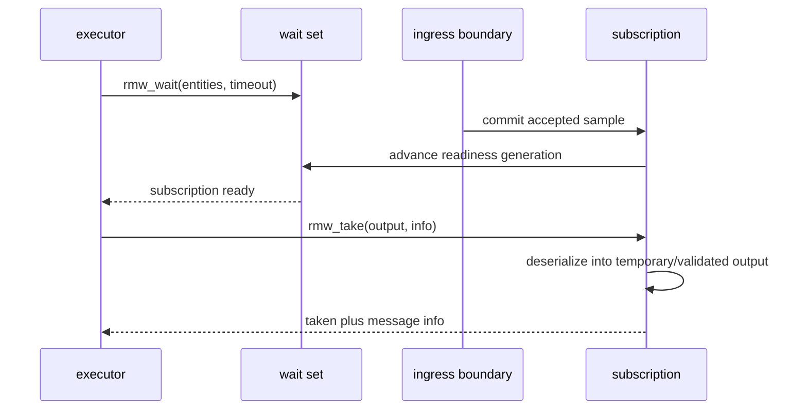

The current ingress boundary signals only after identity, RTPS framing, and
history acceptance succeed. `rmw_take` leaves the caller output logically
unchanged when deserialization fails. Readiness is generation-based so a
signal arriving between inspection and blocking cannot be lost.

## Current wait-set interface and class ownership

The Jazzy ABI passes implementation-private `subscription->data` and
`guard_condition->data` pointers in caller-owned arrays. The implementation
validates each pointer against the wait set's context and fixed registries
before it can block. Eight `WaitSetSlot` records are embedded in each context;
each successful handle owns one allocator-created `rmw_wait_set_t` and one
`WaitSetData` object.

| C API | Current interface contract |
|---|---|
| `rmw_create_wait_set(context, max_conditions)` | active OpenRTDDS context; returns one bounded handle or null with a diagnostic |
| `rmw_destroy_wait_set(wait_set)` | releases an inactive owned handle, including after context shutdown |
| `rmw_wait(subscriptions, guards, services, clients, events, wait_set, timeout)` | filters supported arrays in place and returns ready, timeout, or exact validation/shutdown failure |
| `rmw_trigger_guard_condition(guard)` | commits one trigger generation, advances the context wake generation, then broadcasts |

| Type or member | Responsibility | Bound / synchronization |
|---|---|---|
| `WaitSetSlot` | generation-checks private wait-set ownership | 8 per context; registry mutex for create/destroy |
| `WaitSetData` | context, slot identity, requested condition ceiling, active-wait claim | maximum 32 entries; one active `rmw_wait` |
| `GuardConditionData` | foundation handle, owning context, last consumed trigger generation | serialized by the context wait mutex |
| `wait_generation` | closes the inspect-to-block race | nonzero wrapping value under wait mutex |
| `wait_condition` | blocks without retaining an entity lock | context-owned condition variable |

Each context owns one wakeup primitive shared by a bounded readiness registry.
Guard conditions maintain trigger generations, subscriptions expose nonempty
accepted-sample history, and matched events compare endpoint and last-taken
generations. A wait call
locks the context wake domain, checks all entries, records the wake generation,
then blocks until it changes, shutdown begins, or the absolute monotonic
deadline expires. Spurious wakeups recheck state without extending that
deadline.

The wait call does not allocate, invoke user callbacks, or hold an entity lock
while blocking. It clears non-ready entries from the caller-provided arrays as
required by the pinned `rmw` ABI. Subscription ingress releases its history
lock before acquiring the context wake mutex, so the lock order is always
`wait mutex -> subscription mutex` during inspection and never inverted during
notification. Guard trigger and shutdown serialize their foundation state
change with the same wait mutex before broadcasting.

`rmw_create_wait_set(context, 0)` maps the generic unbounded request to the
documented implementation ceiling of 32. Requests above 32 fail without
claiming a slot. Services and clients expose the readiness of their owned
request/response subscriptions. Publication- and subscription-matched events
are accepted; other event types remain truthfully unsupported at event
initialization. The exact event state machine is specified in
[events-and-conformance.md](events-and-conformance.md), and service composition
is specified in [services.md](services.md).

### Wait return and fault behavior

| Condition | Return | Array effect |
|---|---|---|
| one or more supported entries ready | `RMW_RET_OK` | retain ready entries; clear non-ready entries |
| monotonic deadline reached | `RMW_RET_TIMEOUT` | clear all supported entries |
| context shutdown | `RMW_RET_ERROR` | clear all supported entries and set diagnostic |
| invalid, foreign, stale, or over-capacity entry | `RMW_RET_INVALID_ARGUMENT` | reject before blocking |
| invalid or stale event | `RMW_RET_INVALID_ARGUMENT` | reject before blocking |
| same wait set already active | `RMW_RET_ERROR` | preserve the active wait |

Wait-set destruction is not concurrent with `rmw_wait`; an observed active
claim is rejected. Destruction is available after shutdown, and context
finalization rejects an occupied wait-set slot. Allocation-failure tests cover
both wait-set allocations and verify slot recovery.

## Current bounded best-effort network runtime

Each initialized context owns one `NetworkRuntime` allocated with the context
allocator. It is constructed only after the ROS-independent foundation is
active and is started only after the reserved graph guard condition exists.
The reverse order is mandatory during rollback and shutdown: stop and join the
worker, release the graph guard, finalize foundation ownership, then destroy
the runtime and context storage.

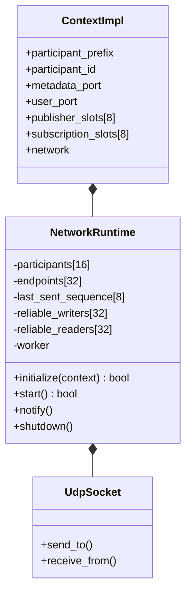

`NetworkRuntime` owns exactly three nonblocking sockets:

| Socket | Bind/destination | Responsibility |
|---|---|---|
| SPDP multicast | DDSI domain multicast port / `239.255.0.1` | receive participant announcements |
| metatraffic unicast | first free DDSI participant metadata port | send SPDP and exchange SEDP |
| user-data unicast | metadata port plus one | send and receive unfragmented DATA |

Initialization scans participant identifiers 0 through 119 and commits the
first metadata/user port pair for which both sockets bind. The participant
GUID prefix contains the OpenRTDDS marker, domain discriminator, selected
participant identifier, and process identifier. The current locator policy
advertises `127.0.0.1`; PR33 therefore qualifies separate processes on one
Linux host, not communication between hosts. A configured interface/address
policy is required before a multi-host deployment claim.

The fixed runtime storage consists of one 2,048-byte SPDP packet, one
65,507-byte receive datagram, one 65,507-byte transmit datagram, two fixed
control datagrams, 16 participant records, 32 endpoint records, one
progress/generation pair for each of the eight publisher slots, 32 reliable
writer links, and 32 reliable reader links. A writer link retains one complete
in-flight DATA datagram; a reader link contains a 256-sequence bitmap. Runtime
discovery and repair do not allocate an endpoint/association object, grow a
container, or create an endpoint-specific thread.

### Worker behavior and bounds

One worker executes the following fair bounded pass and then waits for at most
five milliseconds or until local endpoint/publication notification:

1. every 250 ms, multicast the local SPDP record and unicast every occupied
   publisher/subscription SEDP record to each known participant;
2. receive at most 32 datagrams from each discovery socket;
3. receive at most 32 user datagrams;
4. send at most 32 retained best-effort samples for each occupied publisher and
   admit at most one in-flight sample per reliable writer link;
5. run bounded reliable writer timers and one due HEARTBEAT per link;
6. prune stale reliable associations and expire five-second participant state;
7. sleep on the context-owned worker condition variable.

SPDP is accepted only for the context domain and a nonlocal GUID prefix. SEDP
is accepted only after its participant exists. A participant refresh replaces
its value record; an endpoint refresh replaces the record with the same GUID.
When no free fixed slot exists the new remote record is discarded and existing
state remains unchanged. Participant expiry atomically clears every endpoint
with that participant prefix; an endpoint that is not refreshed is also
removed after five seconds even while its participant remains live. Match
counts are recomputed after either transition.

Matching delegates to the common RTPS endpoint matcher. Topic name, type name,
opposite endpoint kind, reliability compatibility, and volatile durability
must match. Each match recomputation writes the current count under the local
endpoint mutex. These counts are observations of the worker cache and may lag
a just-received discovery packet by one worker pass.

### Publication and receive sequence

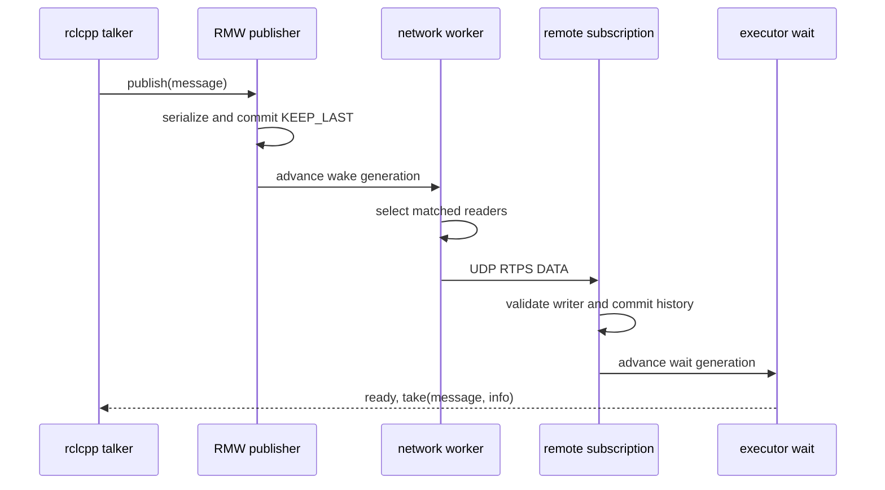

The publisher worker walks retained samples in ascending sequence order after
the slot's last-sent sequence. It rebuilds DATA into the fixed transmit buffer
and attempts one send to every matched reader locator. Progress then advances
regardless of the best-effort send result. When no reader matches, it advances
without sending so volatile QoS does not replay pre-match history to a late
joiner. Progress is per local writer, not per reader, and no hidden retry runs
for a best-effort association. A reliable reader is excluded from this path
and uses the per-association state below.

The receive worker parses one complete DATA datagram, requires a discovered
writer GUID, then applies the same endpoint matcher against each local reader.
Accepted input enters `receive_data_message`, which enforces participant,
reader, writer, payload, duplicate/stale, local-publication, history, and
metadata rules before waking waiters. The current DATA builder does not emit
`INFO_TS`; the receive clock is used for both source and received timestamps so
the RMW metadata remains positive. Precise remote source time requires the
planned timestamp submessage support.

### Reliable association classes and sequence

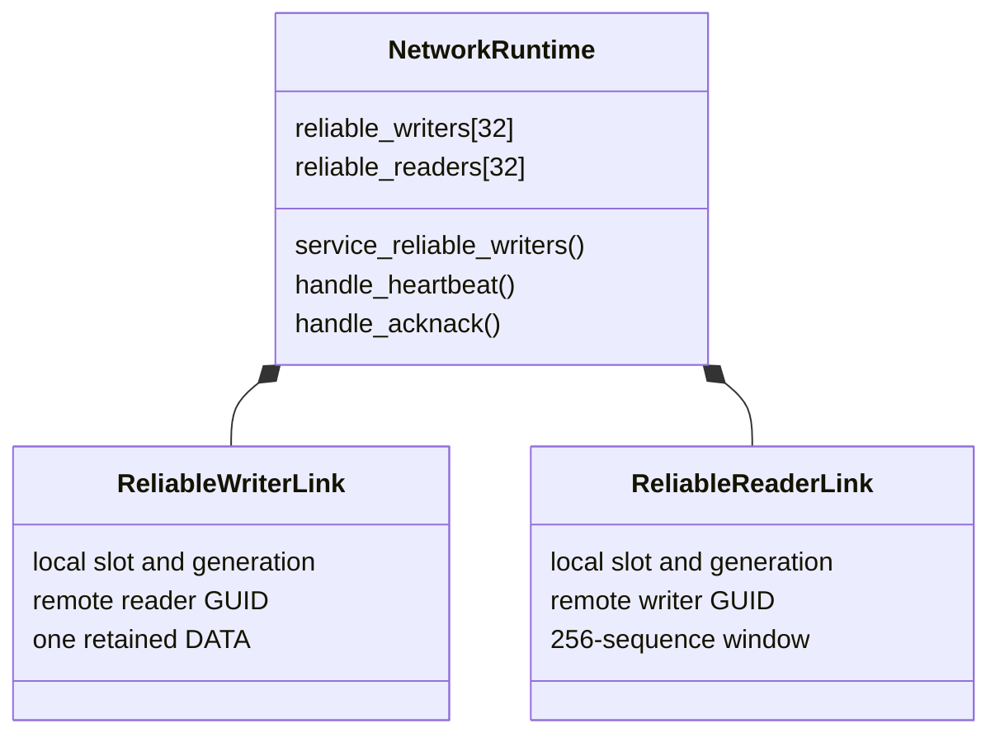

A link key is the local slot/generation and entity ID plus the remote
participant prefix and entity ID. The generation prevents a destroyed and
recreated local endpoint from inheriting prior reliability state. Discovery
expiry or an absent remote endpoint prunes the link. Admission failure at the
32-link bound leaves existing links unchanged; the untracked association gets
no false reliable send.

`ReliableWriterLink` embeds `ReliableWriter<1,65507>`. It accepts a new retained
packet only while empty, permits two ACKNACK-requested retransmissions, and
expires that packet after two seconds. While nonempty the worker emits a
directed non-final HEARTBEAT every 100 milliseconds. ACKNACK is accepted only
when source prefix, reader ID, writer ID, local generation, QoS, and discovery
record all correlate.

`ReliableReaderLink` embeds `ReliableReader<256>`. Its initial sequence is the
first valid DATA sequence or HEARTBEAT first sequence observed after matching,
which implements volatile late-join behavior. DATA updates the window before
subscription ingress, so a retransmission cannot create a second history
sample. HEARTBEAT is normalized from unknown-reader addressing to the matched
local reader, then produces at most one ACKNACK action. Control packets include
`INFO_DST` for the remote participant and use the discovered user locator.

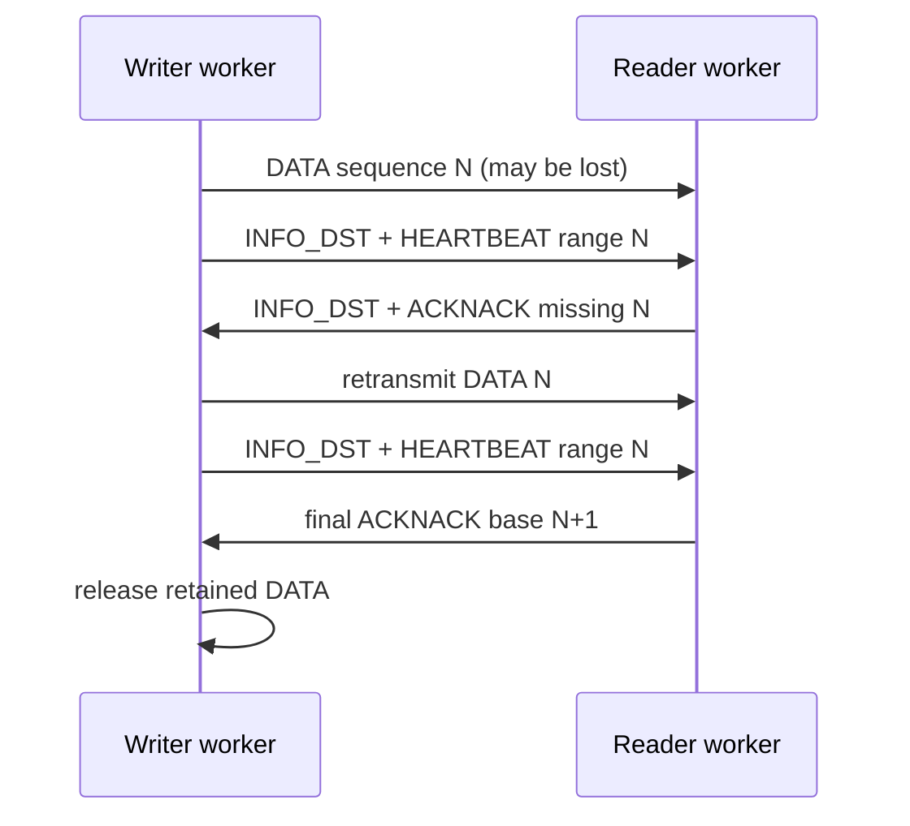

The single worker performs all state transitions. A successful `rmw_publish`
means the publisher history accepted the sample; it does not wait for an
ACKNACK. The current bounded reliable profile intentionally permits one
in-flight sample per association. Higher-throughput windows require a future
configured link-history design and are not implied by G4.2.

### Network interfaces and synchronization

The network layer calls only these private, allocation-free endpoint adapters:

| Interface | Ownership and effect |
|---|---|
| `publisher_network_view` | copies matching identity and borrows immutable SEDP bytes while the publisher registry owns the endpoint |
| `publisher_network_copy_next` | copies/rebuilds the first retained sequence after a supplied value into caller storage |
| `publisher_network_set_match_count` | replaces the observed remote-reader count |
| `subscription_network_view` | copies matching identity and borrows immutable SEDP bytes while the subscription registry owns the endpoint |
| `subscription_network_receive` | applies one matched DATA datagram through the normal ingress commit path |
| `subscription_network_set_match_count` | replaces the observed remote-writer count |
| `notify_network` | advances the worker wake generation without performing network I/O on the caller thread |
| `NetworkRuntime::drop_next_reliable_data_for_test` | internal qualification hook; atomically suppresses a bounded count of initial reliable DATA sends, never control or repair sends |

The reliability wire/state interfaces are the existing
`ReliableWriter::write/on_acknack/on_timer/fill_heartbeat`,
`ReliableReader::on_data/on_heartbeat`, and
`ReliabilityMessageBuilder`/parser APIs. The RMW layer translates their bounded
actions into UDP sends; it does not duplicate their sequence or repair logic.

Registry mutexes prevent endpoint destruction while the worker borrows private
state. The lock order is registry then endpoint. `rmw_publish` and take APIs
hold only the endpoint lock and release it before notifying a worker or wait
condition. The worker never acquires the wait mutex while retaining an
endpoint lock, invokes no user callback, and performs no serialization from a
user-owned ROS object.

### Network errors, faults, and recovery

There is no public `NetworkError` enum in PR33. Startup maps failures to the
existing RMW return contract; asynchronous traffic failures are contained at
the worker boundary:

| Condition | Observable result / state effect | Fault mapping |
|---|---|---|
| multicast socket, membership, port pair, locator, or SPDP construction fails | `rmw_init` returns `RMW_RET_ERROR`; all context/runtime allocations and sockets roll back | `ORT-FLT-UDP-001` or `ORT-FLT-DISC-002` |
| worker thread cannot start | `rmw_init` returns `RMW_RET_ERROR`; graph guard and runtime roll back | `ORT-FLT-RMW-001` |
| nonblocking receive has no packet | normal `would_block`; end current receive pass | none |
| malformed SPDP, SEDP, DATA, HEARTBEAT, or ACKNACK | discard datagram; preserve all local endpoint state | `ORT-FLT-DISC-003` or `ORT-FLT-RTPS-001` |
| unknown participant/writer or incompatible endpoint | discard datagram; no history/wait mutation | `ORT-FLT-DDS-002` when policy promotes the diagnostic |
| participant/endpoint table full | discard new remote record; preserve existing cache | `ORT-FLT-RMW-002` |
| DATA send fails for a matched reader | advance best-effort writer progress; no retry | `ORT-FLT-UDP-002` |
| reliable link table full | preserve admitted links; do not send the untracked association as reliable | `ORT-FLT-RMW-002` |
| stale or foreign reliable control | discard without state change | `ORT-FLT-DDS-002` |
| repair attempts/window exhausted or gap unrepairable | fail or contain the affected sample/link; preserve other associations | `ORT-FLT-REL-001` |
| reliable DATA/control send fails | retain state until its timer/repair bound; never retry outside state-machine actions | `ORT-FLT-UDP-002` |
| five-second lease expires | remove participant/endpoints and recompute counts | normal discovery transition |
| shutdown requested | wake, stop, join, then close all three sockets | none |

The fault codes above define containment ownership. The worker exposes only
compatible endpoint connection and disconnection as matched RMW status events;
it does not reinterpret transport or reliability failures as QoS, deadline,
liveliness, or message-lost events. No asynchronous failure is reported
retroactively from a successful `rmw_publish` call.

### Generic ROS type support and application qualification

Endpoint creation first accepts direct C/C++ introspection metadata or resolves
a generated ROS dispatch handle with `get_message_typesupport_handle`. It asks
only for the two registered Jazzy introspection identifiers and stores the
resolved handle used by schema analysis and XCDR1 conversion. A null dispatch
function or absent supported backend is `TypeSupportError::unsupported_identifier`
and leaves no claimed endpoint slot.

`test_network_runtime.cpp` proves discovery, bidirectional match observation,
best-effort UDP DATA, reliable first-DATA loss and repair, wait wake, take, and
sequence/timestamp metadata between independent contexts.
`run_ros2_topic_matrix.py` selects the installed RMW and runs separate-process
talker/listener pairs for C→C, C→C++, C++→C, and C++→C++ in both best-effort and
reliable modes. `ros2_c_talker_listener.c` uses `rcl`; the C++ executable uses
`rclcpp`; both use generated `std_msgs/msg/UInt32` type support and require
application-visible value 42. This evidence closes G4.2 for the documented
same-host bounded profile.

## Current type-support analysis foundation

`rmw_openrtdds_cpp/type_support.hpp` exposes allocation-free dispatch
resolution and analysis for Jazzy C and C++ introspection handles. The output
is a value-owned `TypeSupportInfo`; generated ROS code continues to own the
input and resolved metadata.

| API/type | Current contract |
|---|---|
| `resolve_type_support` | returns a direct supported handle or resolves a generated dispatch handle to registered introspection C/C++; otherwise returns an exact error |
| `analyze_type_support` | atomically derives the DDS type name and maximum XCDR1 PLAIN_CDR size within a caller-provided sample ceiling |
| `TypeSupportInfo` | language, maximum wire size including the four-byte encapsulation, maximum alignment, maximum nesting depth, and fixed DDS type name |
| `TypeSupportError` | stable exact rejection category; output remains unchanged on failure |

The current accepted subset is boolean, character/octet, integer and floating
scalar kinds up to 64 bits, fixed arrays, bounded sequences, bounded narrow
strings, and nested messages. The recursive walk applies CDR alignment at the
actual accumulated offset, includes the sequence length and string terminator,
and caps nesting at 16. Empty messages have a four-byte maximum wire size.

The analyzer rejects unbounded strings or sequences, wide strings/characters,
long double, malformed member tables, mixed nested introspection languages,
recursive schemas, excessive nesting, arithmetic overflow, and a result above
the configured sample limit. These are schema-validation results, not runtime
fault records; endpoint creation maps them to `ORT-FLT-RMW-003` policy.

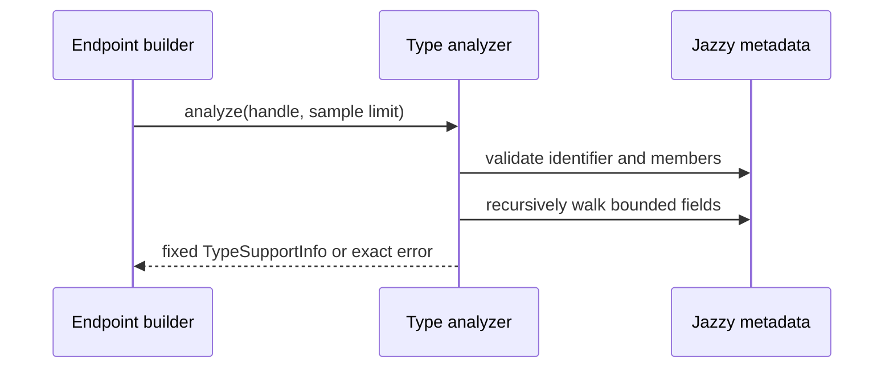

### Current bounded XCDR1 codec

`rmw_openrtdds_cpp/xcdr1_codec.hpp` consumes the analyzed direct C or C++
introspection handle and converts caller-owned ROS message storage to or from
XCDR1 PLAIN_CDR. It supports both byte orders and the same bounded scalar,
array, sequence, narrow-string, and nested-message subset as the analyzer.

| API/type | Contract |
|---|---|
| `serialize_xcdr1` | requires output capacity for the analyzed schema maximum; writes one encapsulated payload without allocation |
| `deserialize_xcdr1` | requires an explicit sample ceiling and pre-sized sequence/string storage; accepts exactly one complete payload |
| `CodecResult` | returns an exact codec error, nested type-support error where applicable, and deterministic byte position |

The receive path deliberately runs twice. Pass one parses the complete wire
sample, validates bounds and callbacks, verifies destination sequence lengths
and string capacities, and rejects trailing bytes. Only after that pass
succeeds does pass two apply decoded values. Malformed input and insufficient
destination storage therefore leave the message unchanged.

```mermaid
sequenceDiagram
    participant R as RMW receive path
    participant C as XCDR1 codec
    participant M as ROS message storage
    R->>C: deserialize(handle, bytes, ceiling, message)
    C->>C: analyze schema and validate full payload
    C->>M: verify pre-sized storage
    alt validation succeeds
      C->>M: apply decoded fields
      C-->>R: bytes consumed
    else validation fails
      C-->>R: exact error; message unchanged
    end
```

No generated resize callback is invoked. C strings require existing capacity;
C++ strings may change length only within existing capacity; bounded sequences
must already have the encoded element count. Endpoint creation reserves
publisher staging and subscription history from analyzed bounds. Serializer
failure can leave partial
bytes in the caller's output buffer, but it never publishes them and reports no
successful size.

ORT-RMW-006 remains Draft only because its full type matrix and reliable G4.2
application evidence are not yet complete; generic ROS dispatch, bounded
endpoint storage, and end-to-end best-effort codec use are current.

## Current name and DDS mapping foundation

`map_ros_to_dds_names` writes one fixed `DdsNames` value without allocation.
Resolved ROS names are expected after `rcl` validation. The pinned mapping is:

| Channel | Normal topic mapping | Literal DDS mode |
|---|---|---|
| topic | `rt` + ROS name | ROS name |
| service request | `rq` + ROS service name + `Request` | ROS service name + `Request` |
| service response | `rr` + ROS service name + `Reply` | ROS service name + `Reply` |

C namespaces replace `__` with `::`; C++ namespaces are retained. Both produce
`<namespace>::dds_::<message>_`. Topic and type outputs allow at most 255 bytes
plus the terminator. Empty or over-bound names fail atomically.

Golden vectors cover all channels, C/C++ type-name equivalence, literal mode,
the 255-byte boundary, and unchanged output after failure. ORT-RMW-007 remains
Draft until publisher, subscription, service, and client creation consume the
mapping and announce the resulting identities through SEDP.

## QoS contract

The implemented normalization, compatibility, resource-planning behavior, and
error decisions are owned by
[the RMW QoS detailed design](../rmw-qos/detailed-design.md). Publisher and
subscription creation consume that object and do not reinterpret raw QoS.

| ROS policy | Initial mapping | Unsupported behavior |
|---|---|---|
| reliability | best effort / reliable; system default becomes reliable | unknown and best available rejected |
| durability | volatile | transient local rejected until bounded durable history exists |
| history | KEEP_LAST | KEEP_ALL rejected |
| depth | fixed positive history depth; system-default history uses configured default | explicit zero/overflow rejected |
| deadline | planned OpenRTDDS deadline monitor | unsupported until monitor evidence exists |
| lifespan | planned receive/write expiry | unsupported until expiry evidence exists |
| liveliness | automatic first | manual modes rejected initially |
| lease duration | bounded monotonic duration | unsupported combinations rejected |

The same normalized QoS object drives entity creation, SEDP advertisement,
matching, `get_actual_qos`, and compatibility checks. No path independently
reinterprets the caller profile.

## Current bounded graph behavior

**Requirements:** ORT-RMW-010, ORT-RMW-020, ORT-RMW-055, ORT-RMW-056

SPDP identifies a participant and SEDP identifies DDS endpoints, but neither
contains the logical ROS node that owns an endpoint. PR35 therefore adds a
versioned OpenRTDDS graph snapshot carried as a private RTPS DATA endpoint. It
is an internal OpenRTDDS-to-OpenRTDDS interface, not a claim of compatibility
with the vendor-specific ROS graph protocols used by other RMWs.

### Classes, records, and ownership

| Type | Responsibility | Fixed bound / owner |
|---|---|---|
| `GraphCache` | owns local and remote committed graph state and nonzero generation | one inline member of `rmw_context_impl_s`; caller synchronizes with `graph_mutex` |
| `GraphNodeRecord` | participant prefix, generation-derived node ID, ROS name, namespace, enclave, locality | 136 total; no pointer ownership |
| `GraphEndpointRecord` | participant/entity identity, owning node ID, kind, ROS and DDS names, naming mode | 48 total; no pointer ownership |
| `RemoteGeneration` | last accepted snapshot generation for one participant | 16 entries, matching remote participant capacity |
| `GraphSnapshot` | dense value copy used by query code | caller stack; 136 nodes and 48 endpoints maximum |
| graph payload/message buffers | serialized snapshot and enclosing RTPS DATA datagram | one 32,768-byte payload and one 32,812-byte message buffer in `NetworkRuntime` |

Local limits are eight nodes and 16 endpoints. The total node capacity is 136
(eight local plus eight nodes for each of 16 remote participants). The total
endpoint capacity is 48 (16 local plus the existing 32 remote SEDP ceiling).
Strings include their terminator in fixed storage: node name 64 bytes,
namespace 128, enclave 256, and each topic/type identity 256.

`NodeData::graph_id` combines the node slot generation and slot index. Endpoint
records retain this ID and the RTPS entity ID, so slot reuse cannot silently
reassign an old endpoint to a new node. A local record is inserted only after
its ordinary RMW/DDS construction succeeds. If graph commit fails, creation
rolls back and exposes no handle. Destruction requires child endpoints to be
gone before its node record can be removed.

### Wire interface

The private graph writer entity ID is `00.00.F1.C2`; the reader ID is unknown.
The RTPS writer sequence is the local graph generation. A separate cache
generation advances for every local or remote commit and is used only for
query/change observation; remote commits never advance the wire generation.
This separation prevents two peers from echoing unchanged snapshots forever.
The serialized payload uses little-endian CDR encapsulation bytes followed by
a bounded private frame:

| Offset | Field | Rule |
|---:|---|---|
| 0 | CDR encapsulation | `00 01 00 00` |
| 4 | magic | ASCII `ORTG` |
| 8 | version / reserved | version 1; every reserved byte zero |
| 10 | node count | unsigned 16-bit; at most 8 |
| 12 | endpoint count | unsigned 16-bit; at most 16 |
| 16 | graph generation | unsigned 64-bit, nonzero and at most signed RTPS sequence maximum |
| 24... | node records | node ID; bounded name, namespace, enclave lengths; exact bytes |
| after nodes | endpoint records | node ID, entity ID, kind, naming flag, four bounded string lengths, exact strings |

The frame has no optional or inferred trailing data. A parser rejects a wrong
encapsulation, magic/version, nonzero reserved field, invalid count, empty or
over-bound required string, duplicate node/entity ID, endpoint without an
announced owner, invalid endpoint kind, payload/RTPS sequence mismatch, stale
generation, unknown participant,
capacity overflow, truncation, or trailing byte. Parsing completes into fixed
temporary arrays before the cache is modified. The commit then removes the
previous snapshot for exactly that participant and inserts the validated
replacement; failure preserves the last valid state.

### Change and expiry sequence

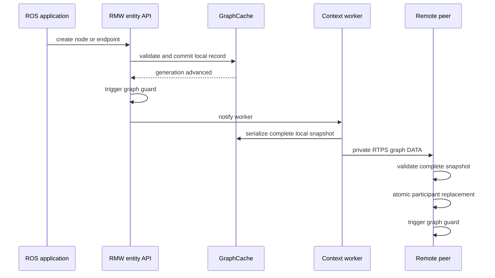

The worker sends SPDP and then the current graph snapshot plus ordinary SEDP
records to each live participant on the 250 ms announcement cadence. A remote
snapshot is accepted only after SPDP established its participant identity. A
graceful endpoint/node destruction advances and announces an empty or reduced
snapshot. If a process disappears without cleanup, the five-second SPDP lease
removes its participant, every SEDP endpoint, every graph node/endpoint, and
reliable association state; the receiving context emits one graph change.

### Implemented graph APIs

| API | Current result |
|---|---|
| `rmw_get_node_names` | names and namespaces from one cache snapshot |
| `rmw_get_node_names_with_enclaves` | names, namespaces, and announced enclaves |
| `rmw_get_topic_names_and_types` | coalesced publisher/subscription topics and unique types |
| `rmw_get_publisher_names_and_types_by_node` | publisher topics for every matching node identity |
| `rmw_get_subscriber_names_and_types_by_node` | subscription topics for every matching node identity |
| `rmw_count_publishers` / `rmw_count_subscribers` | exact cached endpoint count for one validated ROS topic |

Normal queries return ROS topic/type names. `no_demangle=true` returns the DDS
topic and type identities stored in the same endpoint record. Literal DDS
endpoints always retain their literal identity. Output is built in a temporary
`rmw_names_and_types_t` or `rcutils_string_array_t` and assigned only after all
caller-allocator operations succeed. Query-result allocation is required by
the RMW ABI and is outside the deterministic worker path.

Service-name/type graph queries and topic endpoint-information arrays remain
unsupported. Service/client data exchange is Current under G4.4.
The selected APIs validate implementation identity, handle/context lifetime,
allocator validity, zero-initialized outputs, node/topic syntax, and requested
node existence. An absent by-node target returns
`RMW_RET_NODE_NAME_NON_EXISTENT`; fixed-cache exhaustion or malformed network
state never becomes partial query output.

### Errors, faults, and recovery

| Condition | Immediate behavior | Fault ownership |
|---|---|---|
| local record invalid, duplicate, or cache full | entity creation rolls back; `nullptr`/mapped error | `ORT-FLT-RMW-002` or integration defect |
| remote snapshot malformed, stale, duplicate, foreign, or over-bound | discard complete snapshot; retain prior participant state | `ORT-FLT-RMW-004` |
| caller allocator fails while building a query | free temporary result; return `RMW_RET_BAD_ALLOC`; output unchanged | caller/query owner |
| invalid handle/name/namespace/topic/nonzero output | return pinned Jazzy argument or implementation error | caller contract |
| requested node absent | `RMW_RET_NODE_NAME_NON_EXISTENT` | normal graph race/result |
| participant lease expires | atomically remove its graph state and trigger graph guard | normal discovery transition |

`GraphError` provides exact internal categories: `invalid_argument`,
`invalid_record`, `capacity_exceeded`, `duplicate_record`, `record_not_found`,
`stale_snapshot`, `malformed_snapshot`, and `buffer_overflow`. These values are
not wire-stable fault codes. `ORT-FLT-RMW-004` is the stable containment class.

### Concurrency and qualification boundary

All cache mutations and snapshots hold `graph_mutex`; no caller allocation,
network send, endpoint lock, or user callback occurs while that mutex is
retained. Entity creation/destruction may briefly acquire `graph_mutex` while
already holding its registry mutex so the entity slot and graph record commit
as one externally visible transition. No path acquires an entity registry or
endpoint mutex while holding `graph_mutex`; query and network paths use only
the graph lock. Every path releases `graph_mutex` before guard/network
notification. The network worker parses into stack/fixed arrays, commits under
the mutex, releases it, then wakes graph waiters. No graph operation creates a
thread or allocates worker-path memory.

`test_rmw_graph_cache.cpp` covers local lifecycle, exact wire round trip,
stale/malformed atomicity, and participant removal. `test_graph.cpp` covers
the public query and graph-guard contract. `test_network_runtime.cpp` proves
two-context propagation and five-second lease expiry. `run_ros2_graph.py` and
`ros2_graph_probe.cpp` run two separate-process `rclcpp` cases for graceful
removal and forced-process loss. This passes G4.3 only for same-host
OpenRTDDS-to-OpenRTDDS Jazzy graph discovery.

## Service and client behavior

One ROS service maps to request and response pub/sub channels. The client GID
and request sequence form the correlation identity. The fixed outstanding
request table owns a state of `free`, `awaiting_response`, or `completed`.
Responses with an unknown client GID, sequence, or already-completed record are
discarded and counted as diagnostics. Timeout policy belongs to the caller;
the adapter does not retry service requests autonomously.

The implemented wire envelope, API contracts, fixed ownership, sequence flow,
and verification evidence are specified in [services.md](services.md).

## API validation and errors

Every C entry point follows this order:

1. validate required pointers and scalar ranges;
2. validate the implementation identifier;
3. validate context, slot generation, and lifecycle state;
4. reserve bounded resources without making them externally visible;
5. perform the operation;
6. commit or unwind;
7. map the result and set a bounded diagnostic on failure.

Planned adapter-local error categories are stable symbols, not wire values:

| Adapter error | Typical `rmw_ret_t` | Fault mapping | Recovery owner |
|---|---|---|---|
| `RmwError::invalid_argument` | `RMW_RET_INVALID_ARGUMENT` | none; caller contract | caller |
| `RmwError::incorrect_implementation` | `RMW_RET_INCORRECT_RMW_IMPLEMENTATION` | none; caller contract | caller |
| `RmwError::bad_state` | `RMW_RET_ERROR` | `ORT-FLT-RMW-001` | context owner |
| `RmwError::resource_exhausted` | `RMW_RET_BAD_ALLOC` | `ORT-FLT-RMW-002` | system integrator |
| `RmwError::unsupported` | `RMW_RET_UNSUPPORTED` | none; declared limitation | application |
| `RmwError::timeout` | `RMW_RET_TIMEOUT` | optional timing event | executor/application |
| `RmwError::type_support` | `RMW_RET_ERROR` | `ORT-FLT-RMW-003` | application/build owner |
| `RmwError::serialization` | `RMW_RET_ERROR` | `ORT-FLT-SER-001` | publisher/subscriber owner |
| `RmwError::transport` | `RMW_RET_ERROR` | `ORT-FLT-UDP-001/002` | context/system owner |
| `RmwError::discovery` | `RMW_RET_ERROR` | `ORT-FLT-RMW-004` | context/system owner |

`RMW_RET_BAD_ALLOC` includes configured pool or byte-bound exhaustion even when
the failing resource is not the process heap. The diagnostic names the exact
pool or limit. No C entry point permits a C++ exception to cross the ABI.

## Planned fault codes

| Fault code | Detection | Containment and response |
|---|---|---|
| `ORT-FLT-RMW-001` | invalid internal lifecycle or stale active handle | reject call; preserve other entities; request context restart if persistent |
| `ORT-FLT-RMW-002` | configured adapter pool/table/byte bound exhausted | reject creation or sample atomically; emit bounded resource event |
| `ORT-FLT-RMW-003` | type-support identifier/schema/size violates profile | reject endpoint creation; no discovery advertisement |
| `ORT-FLT-RMW-004` | graph update malformed, over-bound, stale, or inconsistent | discard update; preserve last valid graph; expire with participant lease |
| `ORT-FLT-RMW-005` | wait ownership, observation, concurrent-use, or wake failure | reject or abort affected wait; preserve other entities; shutdown on persistent internal failure |

Codes without an owning implementation remain Planned in the central fault
catalog. `ORT-FLT-RMW-005` is Current for the bounded wait implementation.

## Resource model

`RmwLimits` will extend `RuntimeLimits` with maxima for every adapter-owned
entity and byte store. Cross-validation shall ensure, at minimum, that endpoint
capacity covers publishers, subscriptions, client/service pairs, the graph can
describe every local entity plus its allowed remote peers, and wait-set entry
capacity cannot exceed the registry capacity.

All internal names, graph records, serialized samples, event records, and
diagnostics have explicit byte limits. No unbounded STL container is permitted
on the Safety Profile path. General Profile use of a caller allocator remains
visible in the owning type and failure contract.

## Concurrency and timing

The current topology is one receive/discovery worker and one wait wakeup
primitive per context; application publishing and taking occur on
caller/executor threads. Planned reliability timers run in that bounded
context worker, not one thread per endpoint. Real-time priorities and
affinities remain deployment configuration to be validated before a future
Safety Profile activation claim.

Lock order is context lifecycle, graph, entity pool, then individual entity.
The receive worker never calls user code and never waits for an executor. CDR
serialization/deserialization occurs outside the graph lock. Every retry,
discovery announcement, lease, wait, and shutdown join has a monotonic bound.

## Qualification gates

| Gate | Required evidence | Claim enabled |
|---|---|---|
| G4.1 Build/load | Jazzy build/install, exact symbol/load test, runtime selection, failure injection, allocation balance, and init/node/shutdown ASan/LSan/UBSan stress | Passed by PR26: adapter lifecycle scaffold loads |
| G4.2 Topics | C/C++ fixed-message best-effort and reliable cross-language talker/listener matrix, forced-loss repair, QoS and metadata tests | Passed by PR34 for the documented same-host bounded profile |
| G4.3 Graph | multi-process graph add/query/remove and lease-expiry tests | Passed by PR35 for selected same-host OpenRTDDS graph introspection |
| G4.4 Services | concurrent request/reply correlation, wait readiness, invalid response test | bounded ROS services |
| G4.5 Conformance | versioned upstream allowlist, exclusions, stress, sanitizers, determinism analysis | ROS 2 Jazzy readiness for documented profile |

G4.1, G4.2, and G4.3 are passed; G4 remains Planned until all five gates pass. Passing a lower
gate shall be claimed precisely and shall not be described as general ROS 2
support.

## Verification strategy

- unit tests cover lifecycle order, handle generation, mappings, size analysis,
  QoS normalization, wait generations, graph transactions, service correlation,
  and every error mapping;
- integration tests load the adapter through standard ROS runtime selection;
- examples provide fixed talker/listener and service/client demonstrations;
- multi-process tests exercise discovery, graph expiry, reliable repair, and
  bounded shutdown;
- ASan, UBSan, TSan where supported, and leak checks cover General Profile;
- allocation hooks prove no post-activation heap calls in Safety Profile tests;
- latency tests record wait wake, publish, take, and shutdown bounds without
  treating a non-real-time CI host as WCET proof;
- the selected upstream test allowlist and every exclusion are committed.

## Deliberate limitations

The planned first adapter is not a complete DDS RMW replacement and is not a
safety-certified ROS 2 stack. It supports only the documented Jazzy ABI,
Linux, bounded message/profile subset, UDPv4 transport, and qualification
tests. ROS 2 client libraries, executors, third-party nodes, and vendor RMW
implementations may allocate or create threads outside OpenRTDDS control.
