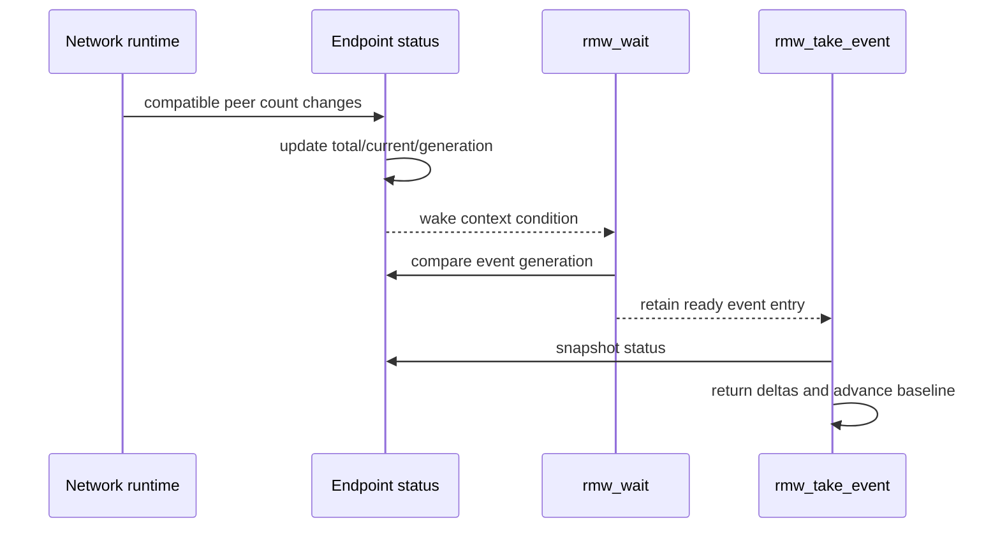

# Matched events and Jazzy conformance selection

## Scope

PR37 implements only the two RMW statuses for which the current middleware has
truthful evidence:

| Event | Source evidence | Status payload |
|---|---|---|
| `RMW_EVENT_PUBLICATION_MATCHED` | publisher compatible-reader count | `rmw_matched_status_t` |
| `RMW_EVENT_SUBSCRIPTION_MATCHED` | subscription compatible-writer count | `rmw_matched_status_t` |

Deadline, liveliness, incompatible-QoS, incompatible-type, and message-lost
events remain unsupported. Their initialization returns
`RMW_RET_UNSUPPORTED`; `rmw_event_type_is_supported()` returns `false` without
setting an error. This preserves ORT-RMW-013's truthful-evidence rule.

## State and bounds

Each context owns 16 generation-checked event slots. Event initialization uses
the context allocator once, records the source endpoint, and snapshots its
cumulative and current match counts. No allocation occurs in status updates,
`rmw_wait()`, or `rmw_take_event()`.

The endpoint maintains:

- a cumulative total, incremented only when the current match count rises;
- the current compatible peer count; and
- a nonzero change generation incremented on connect or disconnect.

An event is ready when the endpoint generation differs from the event's last
taken generation. Multiple peer changes before a take collapse into one ready
condition while the returned count deltas preserve their aggregate effect.

## API and error contract

| API | Success | Deterministic failures |
|---|---|---|
| `rmw_publisher_event_init` | creates publication-matched event | invalid handle/arguments; unsupported type; exhausted 16-slot pool |
| `rmw_subscription_event_init` | creates subscription-matched event | invalid handle/arguments; unsupported type; exhausted pool |
| `rmw_wait` | retains ready event pointers and clears non-ready pointers | invalid/stale event or condition-capacity overflow |
| `rmw_take_event` | first take returns the initial status; later takes return one aggregate transition or `taken=false` | invalid/stale event or destroyed source |
| `rmw_event_fini` | releases and generation-invalidates the event slot | foreign, invalid, or stale event |
| `rmw_event_set_callback` | installs, replaces, or clears a bounded callback registration | invalid or stale event |

The endpoint and event registry generations prevent stale handles from becoming
valid when a bounded slot is reused. Context finalization is rejected while any
event slot remains occupied.

## Selected Jazzy conformance allowlist

`rmw_openrtdds_cpp/test/jazzy_conformance_allowlist.txt` pins the reviewed
upstream Jazzy suites and maps each to a local qualification test. The mapping
is intentionally an allowlist: it does not claim that excluded upstream suites
pass, and it cannot expand silently. `rmw_openrtdds_conformance_allowlist`
checks that each mapped local test remains registered and that event/wait-set
coverage cannot be removed from the selection.

The PR37 gate consists of the direct event test, the wait-set test, the
allowlist integrity test, the complete Jazzy ABI check, and the sanitizer job.
Running the pinned upstream sources themselves remains a PR38 deployment
qualification activity; the allowlist records the exact subset approved for
that run and does not claim those upstream suites already pass.
