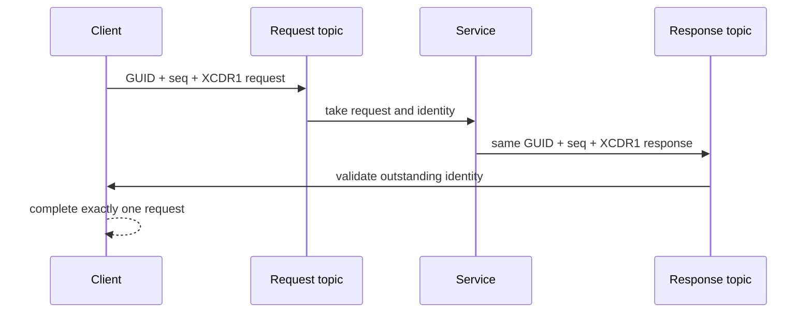

# Bounded ROS 2 service/client design

**Status:** Current  
**Requirements:** ORT-RMW-011, ORT-RMW-021

## Scope and behavior

One ROS service is composed from the already-qualified publisher/subscription
path. A client owns a request publisher and response subscription; a service
owns a request subscription and response publisher. These internal endpoints
participate in SEDP matching but are not inserted as ordinary topic endpoints
in the ROS graph cache.

| ROS object | Request channel | Response channel |
|---|---|---|
| Client | publisher on `rq<service>Request` | subscription on `rr<service>Reply` |
| Service | subscription on `rq<service>Request` | publisher on `rr<service>Reply` |

Creation resolves the generated service handle to pinned Jazzy C or C++
introspection request/response handles. Both message types must satisfy the
existing 65,000-byte bounded XCDR1 profile before either object becomes
visible. A partial endpoint pair is destroyed before creation reports failure.

## Correlation wire interface

Service samples use a private, fixed-size envelope followed by a complete
XCDR1 message:

| Offset | Size | Field | Encoding |
|---:|---:|---|---|
| 0 | 16 | client request-writer GUID | opaque bytes |
| 16 | 8 | request sequence | unsigned two's-complement bits, little-endian |
| 24 | bounded | request or response | complete XCDR1 payload including encapsulation |

The envelope is carried as the RTPS DATA serialized payload. It is only used
on `rq` and `rr` service channels; ordinary topic DATA remains byte-for-byte
unchanged. The client GID is the request publisher GID. Request sequences start
at one, increase monotonically after successful publication, and never wrap.

## Class and ownership definition

| Type | Owned state | Bound / synchronization |
|---|---|---|
| `ClientData` | parent node, hidden endpoints, stable GID, next sequence, outstanding table | 32 outstanding entries; one mutex serializes send/take |
| `ServiceData` | parent node, request subscription, response publisher | endpoint locks provide send/take serialization |
| `OutstandingRequest` | request sequence and occupied flag | fixed array; no runtime growth |
| service publisher storage | XCDR1 staging, 24-byte envelope, DATA staging, history | QoS depth × fixed serialized capacity |
| service subscription storage | envelope-bearing receive history | QoS depth × fixed serialized capacity |

Each client or service consumes one publisher slot and one subscription slot
from the existing context bounds. No request, response, wait, or correlation
operation allocates after object creation.

## API contracts

| API | Current contract |
|---|---|
| `rmw_create_client` / `rmw_create_service` | atomically construct a bounded endpoint pair or return null |
| `rmw_send_request` | reserve an outstanding slot, publish one correlated request, then return its sequence |
| `rmw_take_request` | nonblocking take of one request plus source/receive time and request identity |
| `rmw_send_response` | publish one response with the caller-provided identity from a taken request |
| `rmw_take_response` | discard foreign/unknown/completed identities and return the first valid outstanding response |
| service/client QoS getters | delegate to the corresponding hidden endpoint's normalized QoS |
| `rmw_get_gid_for_client` | return the stable request-writer GID |
| `rmw_service_server_is_available` | true only when both request and response directions are matched |
| `rmw_wait` | service readiness follows request history; client readiness follows response history |

Timeout and application retry policy remain outside the adapter. OpenRTDDS
does not automatically resend an application request. Transport reliability
may repair RTPS DATA according to the existing reliable endpoint profile.

## Rejection and fault behavior

| Condition | Result | State guarantee |
|---|---|---|
| null, foreign, stale, or wrong-parent handle | specific `rmw_ret_t` and diagnostic | valid owned state is retained |
| unsupported/unbounded service member type | creation fails | no endpoint pair remains |
| endpoint or outstanding table exhausted | creation/send fails | existing entries remain valid |
| truncated envelope or invalid XCDR1 body | take returns `RMW_RET_ERROR` | queued sample is retained for diagnostic handling |
| unrelated client GUID | response is consumed and discarded | outstanding table unchanged |
| unknown or already-completed sequence | response is consumed and discarded | no request completes twice |
| sequence maximum reached | send returns `RMW_RET_ERROR` | no publication or table mutation |
| wait timeout | `RMW_RET_TIMEOUT` | service/client array entries are cleared |

Correlation rejection maps to `ORT-FLT-RMW-007`. Capacity exhaustion maps to
`ORT-FLT-RMW-002`; service type rejection maps to `ORT-FLT-RMW-003`; codec and
RTPS failures retain their existing mappings.

## Verification and example

`test_services.cpp` verifies lifecycle, stable GID, readiness, request metadata,
foreign-GID rejection, valid correlation, multiple outstanding requests, QoS
endpoint composition, and complete cleanup. `ros2_add_service.cpp` plus
`run_ros2_service.py` execute a two-process `rclcpp` AddTwoInts exchange with
`RMW_IMPLEMENTATION=rmw_openrtdds_cpp`. Sanitizer CI runs the same test set.
